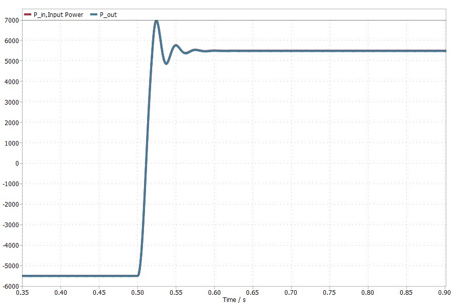
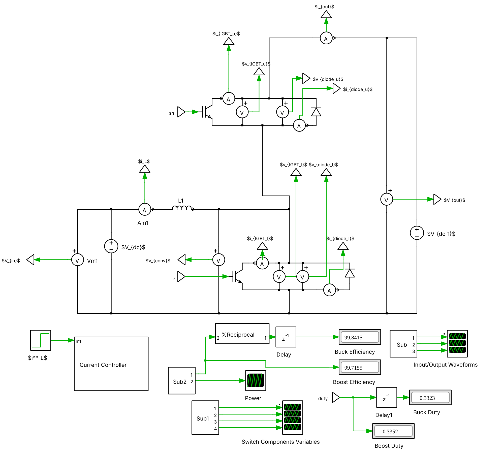
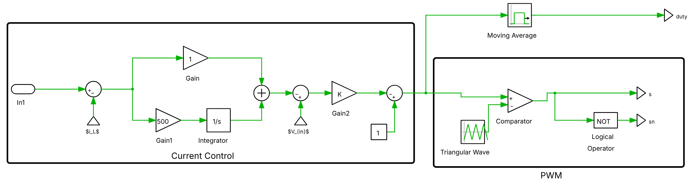
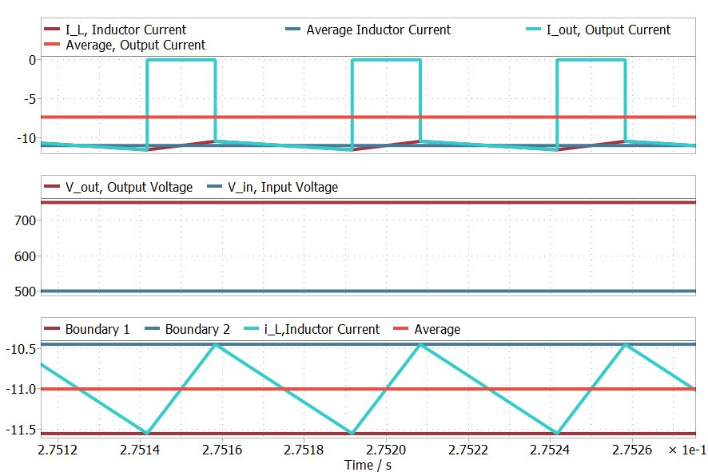
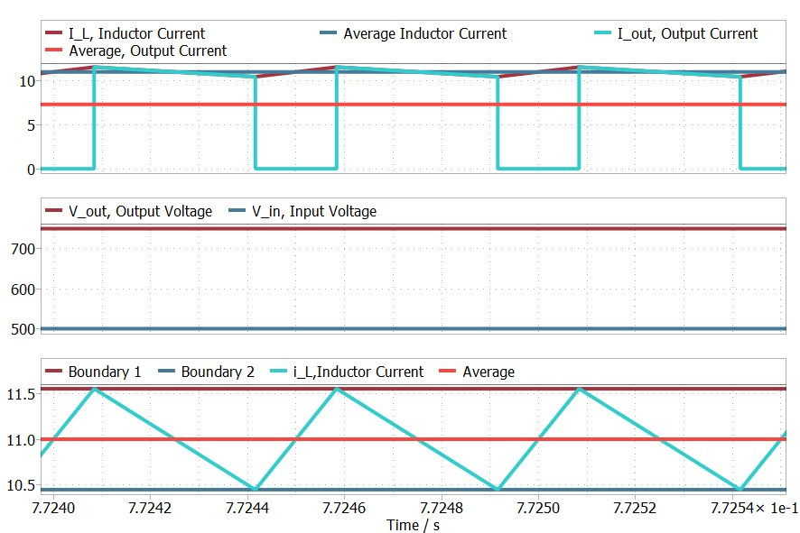
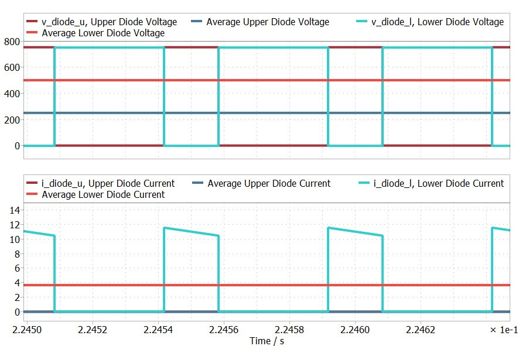
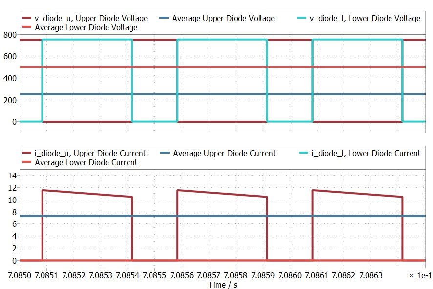
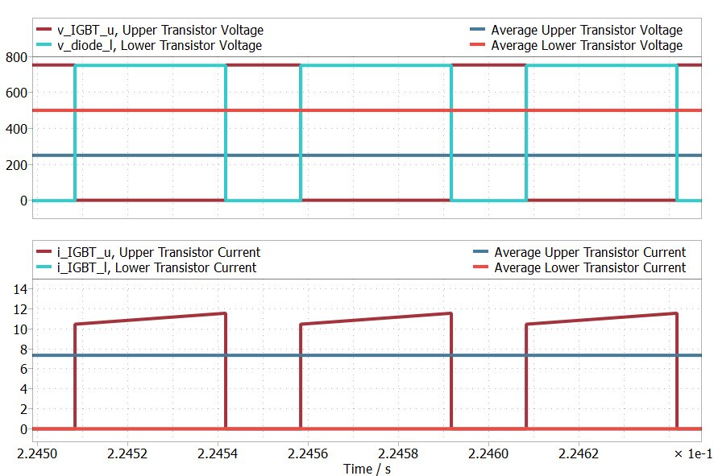
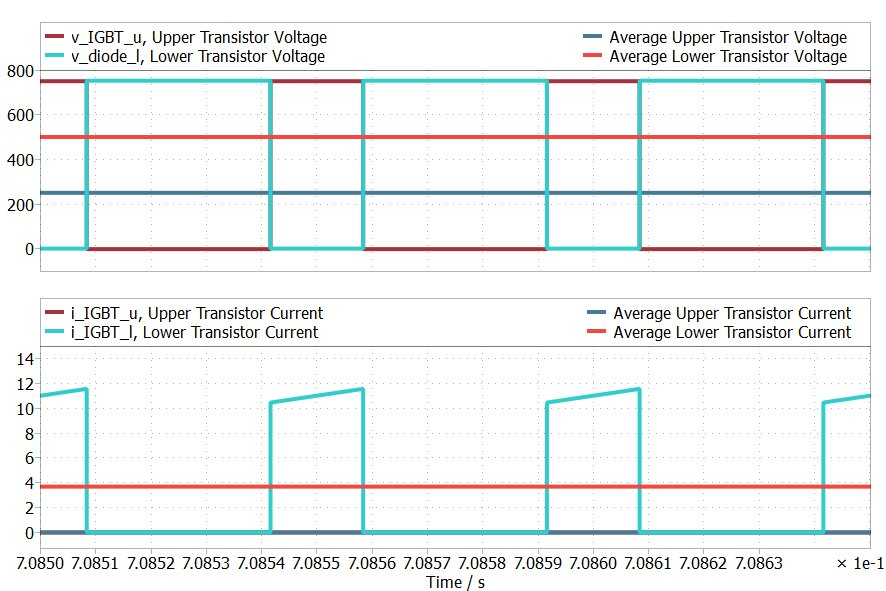

# Bidirectional Synchronous DC/DC Converter (500 V ↔ 750 V, 5.5 kW)

Design and PLECS simulation of a **bidirectional synchronous buck/boost converter** linking a 500 V DC bus to a 750 V DC bus at **5.5 kW**, with **closed-loop PI current control**. The components were picked from real market datasheets, and the conduction losses from those datasheets are included in the model.

Power Electronics course project, Warsaw University of Technology, summer semester 2025.
**Authors:** Nurmukhammed Polat, Krzysztof Stępień

*Power flow reverses from −5.5 kW (buck) to +5.5 kW (boost) when the current reference steps at t = 0.5 s.*

## Specification

| Parameter | Value |
|---|---|
| Low-side voltage Vin | 500 V |
| High-side voltage Vout | 750 V |
| Rated power | 5.5 kW |
| Switching frequency | 20 kHz |
| Inductor current ripple | ≤ 10 % of average current |

## Design calculations

| Quantity | Calculation | Result |
|---|---|---|
| Average inductor current | IL = P / Vin = 5.5 kW / 500 V | **11 A** |
| Duty cycle (ideal boost) | D = 1 − Vin/Vout | **1/3** |
| Minimum inductance | L ≥ \|Vin − Vout\|(1 − D) / (fsw · 0.1 IL) | **≥ 7.58 mH → 7.6 mH chosen** |
| IGBT on-resistance | Slope of the datasheet VCE–IC curve | **15 mΩ** |
| Diode on-resistance | Slope of the datasheet VF–IF curve, VF0 = 1.8 V | **23.3 mΩ** |

A suitable IGBT module with an antiparallel diode was found as a stock part. No off-the-shelf inductor rated for 7.6 mH at 11 A was available, so in a real build the inductor would have to be custom-wound.

## Simulation model

- Two IGBTs with antiparallel diodes in a half-bridge between the 500 V and 750 V sources, with a 7.6 mH inductor on the low side
- Conduction losses modelled using the datasheet Ron and Vf values
- Live readouts of buck and boost efficiency and duty cycle

### Current controller

A **PI controller** sets the inductor current to the reference. Its output goes to a PWM stage that compares the duty cycle against a 20 kHz triangle carrier. Stepping the reference from **−11 A to +11 A** reverses the power flow. This replaces tuning the duty cycle by hand, which would otherwise have to be done separately for each direction because of the losses.

## Results

### Bidirectional operation

| Buck mode (750 V → 500 V) | Boost mode (500 V → 750 V) |
|---|---|
|  |  |

- Steady state is reached in both directions at the nominal ±11 A and ±5.5 kW.
- The inductor ripple stays within the **±5 % boundaries** (10.45–11.55 A), which meets the ≤ 10 % specification.
- Efficiency is close to 100 % because only conduction losses are modelled. Buck efficiency is higher than boost, because in boost mode a larger share of the current flows through the higher-resistance element.

### Switch stresses

| | Buck mode | Boost mode |
|---|---|---|
| **Diodes** |  |  |
| **IGBTs** |  |  |

- Peak voltage and current stresses are about **half of the datasheet limits**, which leaves generous headroom.
- The commutation pattern is as expected. In buck mode the upper IGBT and lower diode conduct. In boost mode the lower IGBT and upper diode conduct.

## Limitations and next steps

- Switching and thermal losses aren't modelled, and neither is dead-time.
- The next step would be a detailed SPICE-level simulation with full device models, then thermal design.

## Files

| File | Content |
|---|---|
| `bidirectional_dcdc_converter.plecs` | Final PLECS model with the PI current controller |
| `proof_of_concept.plecs` | Initial open-loop proof-of-concept model (fixed duty, no losses) |
| [`Synchronous_DCDC_Converter_Report.pdf`](Synchronous_DCDC_Converter_Report.pdf) | Full project report |
| `*.png`, `*.jpg` | Figures used in this README |

Open the `.plecs` files in **PLECS Standalone 4.9** or later. The simulation runs a buck phase from 0 to 0.5 s, then switches to boost.

## Skills

Power electronics · DC/DC converter design · PLECS · PI current control · PWM · Component selection from datasheets · Loss modelling

## Authors

**Nurmukhammed Polat** ([LinkedIn](https://www.linkedin.com/in/nurmukhammed-polat-6a6677251/)) and **Krzysztof Stępień**, Electrical Engineering, Warsaw University of Technology
